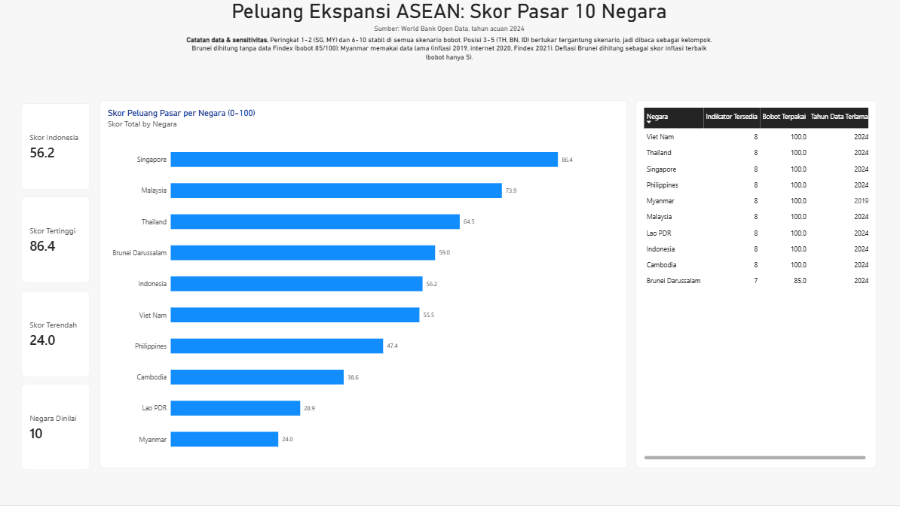
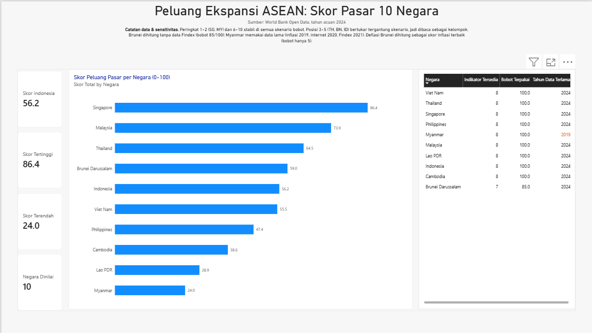
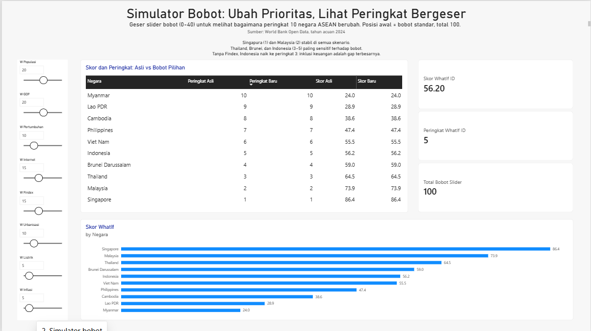
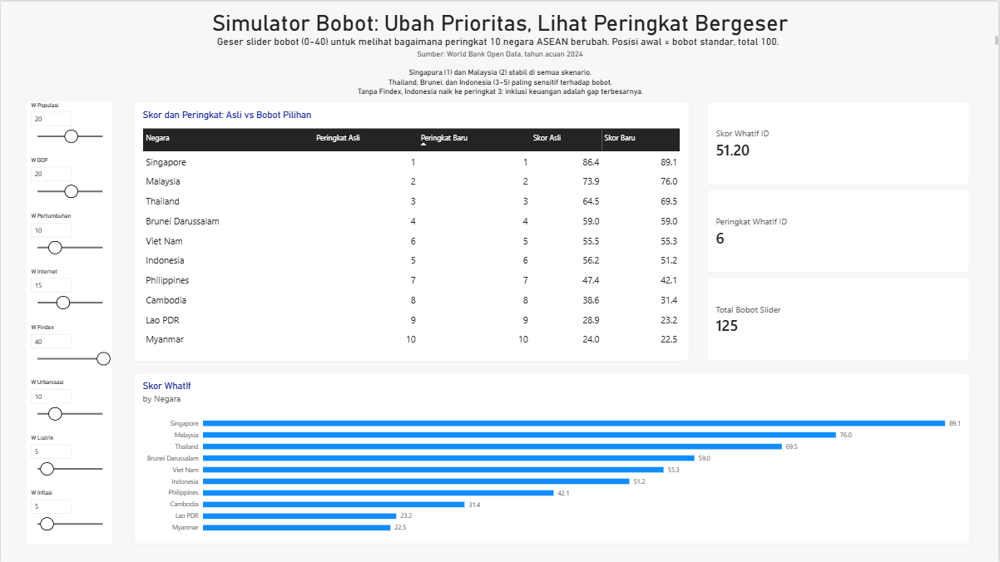
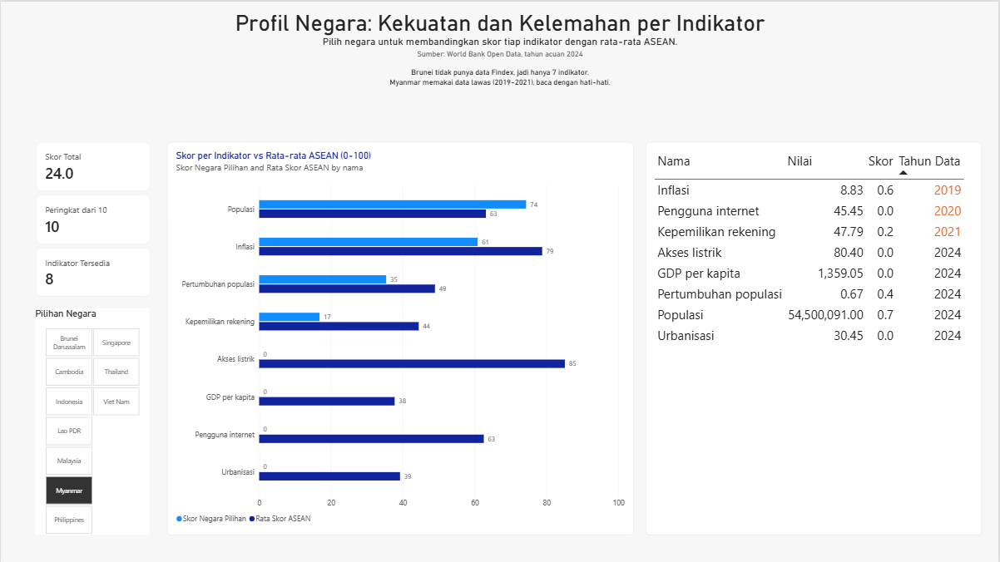
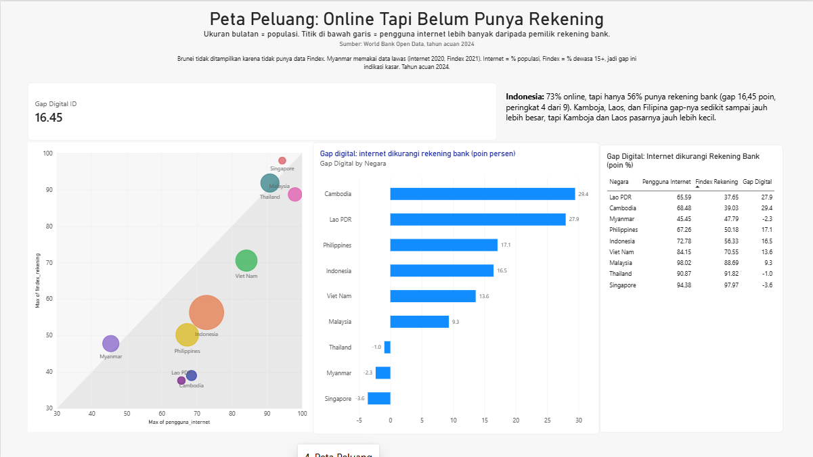
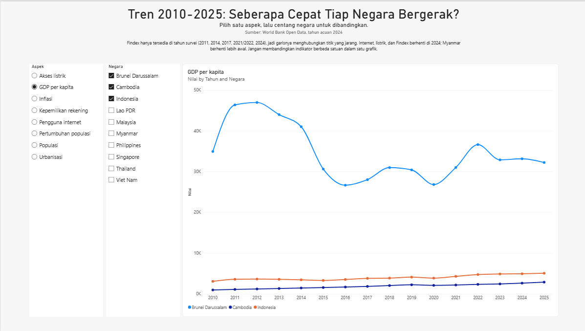
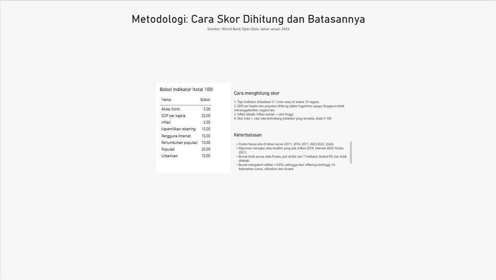
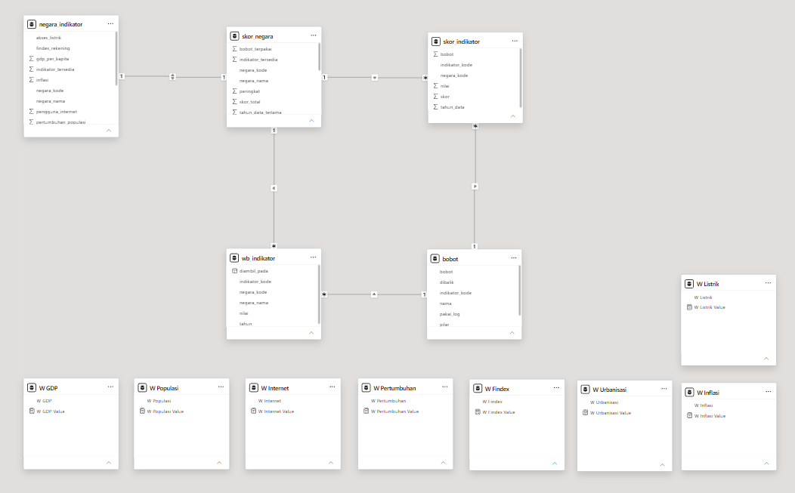
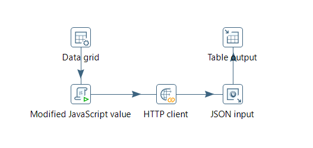

# ASEAN Market Opportunity Scorecard

Dashboard BI yang menjawab satu pertanyaan bisnis:

> **Kalau perusahaan e-commerce/fintech mau ekspansi di ASEAN, negara mana yang diprioritaskan, dan seberapa yakin kita?**

Proyek ini dibangun dengan pipeline sungguhan (API, ETL, database 3 lapis, scoring di SQL, dashboard Power BI), bukan sekadar impor CSV. Terkait SDG 8 (pekerjaan layak dan pertumbuhan ekonomi) dan SDG 9 (industri, inovasi, infrastruktur).

**[Lihat PDF dashboard (6 halaman)](docs/ASEAN_scorecard.pdf)**



## Tampilan dashboard

**Ringkasan.** Peringkat 10 negara, kartu KPI, dan tabel kualitas data.


**Simulator bobot (default).** Delapan slider bobot, skor dan peringkat dihitung ulang langsung.


**Simulator, bobot Findex = 0.** Tanpa inklusi keuangan, Indonesia naik ke peringkat 3 (skor 60,7).


**Simulator, bobot Findex = 40.** Bobot inklusi keuangan dinaikkan, Indonesia turun ke peringkat 6 (skor 51,2), di bawah Vietnam.


**Profil negara.** Skor per indikator dibanding rata-rata ASEAN.


**Peta peluang.** Pengguna internet vs kepemilikan rekening bank, gap digital per negara.


**Tren 2010-2025.**


**Metodologi dan keterbatasan.**


**Model relasi.**


## Temuan utama

| Peringkat | Negara    | Skor                                            |
| --------- | --------- | ----------------------------------------------- |
| 1         | Singapura | 86,4                                            |
| 2         | Malaysia  | 73,9                                            |
| 3         | Thailand  | 64,5                                            |
| 4         | Brunei    | 59,0 (bobot terpakai 85 dari 100, tanpa Findex) |
| 5         | Indonesia | 56,2                                            |
| 6         | Vietnam   | 55,5                                            |
| 7         | Filipina  | 47,4                                            |
| 8         | Kamboja   | 38,6                                            |
| 9         | Laos      | 28,9                                            |
| 10        | Myanmar   | 24,0 (data terlama 2019)                        |

1. **Peringkat 1-2 (SG, MY) dan 7-10 stabil** di semua skenario bobot yang diuji.
2. **Thailand, Brunei, Indonesia, dan Vietnam (posisi 3-6) rapuh.** Urutannya berubah kalau bobot diubah, jadi dibaca sebagai satu kelompok, bukan peringkat pasti. Selisih skor Indonesia dan Vietnam hanya 0,7 poin.
3. **Inklusi keuangan adalah gap terbesar Indonesia.** Tanpa indikator rekening bank (Findex), Indonesia naik dari peringkat 5 ke 3. Sebaliknya, kalau bobot Findex dinaikkan ke 40, Indonesia turun ke peringkat 6. Artinya pengguna internet sudah banyak, tapi rekening bank baru sekitar 56%: ruang tumbuh untuk fintech.
4. **Brunei peringkat 4 sebagian karena Findex-nya tidak ada**, bukan murni karena kuat. Skornya tidak berubah (59,0) di semua skenario bobot Findex.

### Rekomendasi

- **Prioritas utama: Singapura dan Malaysia.** Peringkat 1-2 di semua skenario bobot.
- **Tier tengah (Thailand, Brunei, Indonesia, Vietnam):** pilihan bergantung pada strategi, karena urutannya bergeser saat bobot berubah. Brunei dibaca hati-hati karena tanpa data Findex.
- **Indonesia cocok untuk fintech:** pengguna internet jauh di atas kepemilikan rekening bank (sekitar 56%), dan populasinya terbesar di ASEAN.
- **Kamboja dan Laos:** gap internet vs rekening bank besar, tapi pasarnya kecil, jadi bukan prioritas awal. Myanmar skor terendah dengan data lawas.

### Uji sensitivitas

Angka di tabel adalah peringkat.

| Negara         | Skor asli   | Bobot sama | Tanpa Findex | Findex 40 |
| -------------- | ----------- | ---------- | ------------ | --------- |
| SG             | 1           | 1          | 1            | 1         |
| MY             | 2           | 2          | 2            | 2         |
| TH             | 3           | 4          | 4            | 3         |
| BN             | 4           | 3          | 5            | 4         |
| ID             | 5           | 5          | 3            | 6         |
| VN             | 6           | 6          | 6            | 5         |
| PH, KH, LA, MM | 7, 8, 9, 10 | sama       | sama         | sama      |

Skenario "Tanpa Findex" dan "Findex 40" diverifikasi langsung di simulator Power BI (halaman 2).

---

## Arsitektur

```text
World Bank Open Data API
        |
        v   Pentaho Data Integration (PDI)
  raw.wb_indikator          (1.280 baris, semua kolom text)
        |
        v   SQL (PostgreSQL 16, Docker)
  staging.wb_indikator      (tipe data bersih, NULL tetap NULL)
  staging.indikator_terbaru (nilai terakhir per indikator-negara, tahun <= 2024)
        |
        v   SQL
  mart.negara_indikator -> mart.bobot -> mart.skor_indikator -> mart.skor_negara
        |
        v   Power BI Desktop (mode Import)
  Dashboard 6 halaman
```

| Lapisan             | Tool                         | Fungsi                                                                           |
| ------------------- | ---------------------------- | -------------------------------------------------------------------------------- |
| Ingest              | PDI (Spoon)                  | Panggil API, parse JSON, tulis ke `raw` (idempotent, tabel di-truncate tiap run) |
| Data quality        | Python (`src/cek_detail.py`) | Hitung kelengkapan per indikator dan negara                                      |
| Transform + scoring | SQL                          | Staging, mart, normalisasi, pembobotan                                           |
| Visualisasi         | Power BI                     | Ringkasan, simulator bobot, profil negara, peta peluang, tren, metodologi        |

**Transformasi ingest di PDI.** Panggil API World Bank, parse JSON, tulis ke `raw.wb_indikator`.


---

## Data

- **Sumber:** World Bank Open Data API (gratis, tanpa API key).
- **Cakupan:** 10 negara ASEAN (ID, MY, TH, VN, PH, SG, BN, KH, LA, MM), 2010 sampai 2025.
- **Volume:** 8 indikator x 10 negara x 16 tahun = 1.280 baris, dengan 1.132 baris berisi nilai.
- **Tahun acuan scoring:** 2024 (nilai terakhir yang tersedia per indikator). Grafik tren memakai 2010-2025.

| Indikator                          | Kode World Bank     | Pilar            | Bobot |
| ---------------------------------- | ------------------- | ---------------- | ----- |
| GDP per kapita                     | `NY.GDP.PCAP.CD`    | Daya beli        | 20    |
| Populasi                           | `SP.POP.TOTL`       | Ukuran pasar     | 20    |
| Pertumbuhan populasi               | `SP.POP.GROW`       | Pertumbuhan      | 10    |
| Pengguna internet                  | `IT.NET.USER.ZS`    | Kesiapan digital | 15    |
| Kepemilikan rekening bank (Findex) | `FX.OWN.TOTL.ZS`    | Kesiapan digital | 15    |
| Urbanisasi                         | `SP.URB.TOTL.IN.ZS` | Infrastruktur    | 10    |
| Akses listrik                      | `EG.ELC.ACCS.ZS`    | Infrastruktur    | 5     |
| Inflasi                            | `FP.CPI.TOTL.ZG`    | Stabilitas       | 5     |

---

## Metode scoring

1. **Normalisasi min-max** per indikator ke skala 0-1.
2. **Transformasi log (`ln`)** untuk GDP per kapita dan populasi, supaya Singapura (GDP ~94.897) dan Indonesia (populasi besar) tidak menekan semua negara lain ke angka nol.
3. **Inflasi dibalik** (`1 - skor`): inflasi rendah = skor tinggi.
4. **Skor total** = `sum(skor x bobot) / sum(bobot)` atas indikator yang **tersedia**. Jadi negara dengan data kosong (Brunei tanpa Findex) tidak dihukum nol, tapi dibagi dengan bobot yang terpakai (85, bukan 100). Kolom `bobot_terpakai` dan `tahun_data_terlama` ditampilkan di dashboard supaya pembaca tahu seberapa yakin angkanya.

---

## Halaman dashboard

| Halaman           | Isi                                                         |
| ----------------- | ----------------------------------------------------------- |
| 1 Ringkasan       | Kartu KPI, peringkat negara, tabel kualitas data            |
| 2 Simulator bobot | 8 slider bobot, skor dan peringkat dihitung ulang (what-if) |
| 3 Profil negara   | Skor per indikator dibanding rata-rata ASEAN                |
| 4 Peta peluang    | Pengguna internet vs rekening bank, gap digital per negara  |
| 5 Tren            | Tren indikator 2010-2025 per negara                         |
| 6 Metodologi      | Bobot, kelengkapan data, keterbatasan                       |

---

## Keterbatasan

- **Data tahunan, bukan live.** Nilai proyek ini ada di modeling, scoring, dan sensitivitas, bukan di refresh real-time.
- **Findex hanya ada di tahun survei** (2011, 2014, 2017, 2021/2022, 2024), jadi dipakai nilai terakhir yang ada.
- **Brunei tidak punya data Findex.** Tidak ditebak; skornya dihitung dari 7 indikator.
- **Myanmar memakai data lawas** (inflasi terakhir 2019, internet 2020, Findex 2021). Tahun datanya ditandai di dashboard.
- **Inflasi Brunei negatif (deflasi, -0,4%).** Rumus dibiarkan apa adanya, sehingga Brunei mendapat skor inflasi terbaik. Dicatat sebagai keterbatasan.
- **Bobot bersifat subjektif.** Karena itu ada uji sensitivitas dan simulator bobot.
- **Total bobot slider tidak harus 100.** Skor dibagi total bobot, jadi tetap berskala 0-100 (misalnya total 125 saat Findex = 40).
- Outlier: inflasi Laos 23,13%.

---

## Struktur repo

```text
ASEAN_Scorecard/
├── src/      tes_api.py, cek_detail.py      script pengecekan API dan data quality
├── sql/      01_schemas.sql ... 06_cek_sensitivitas.sql
├── pdi/      tr_ingest_worldbank.ktr        transformasi ingest PDI
├── powerbi/  asean_scorecard.pbix
├── docs/     PDF dashboard, GIF simulator, screenshots/
└── README.md
```

---

## Cara menjalankan

**Prasyarat:** Docker Desktop, Pentaho Data Integration 9.4 (Java 8), Python 3.13, Power BI Desktop.

1. **Jalankan PostgreSQL** (ganti `<password>` dengan password sendiri, jangan di-commit):

   ```powershell
   docker run -d --name asean-pg -e POSTGRES_USER=asean -e POSTGRES_PASSWORD=<password> `
     -e POSTGRES_DB=asean_scorecard -p 5434:5432 -v asean_pgdata:/var/lib/postgresql/data `
     --restart unless-stopped postgres:16
   ```

2. **Kredensial PDI:** isi variabel `ASEAN_DB_HOST`, `ASEAN_DB_PORT`, `ASEAN_DB_PASSWORD` di `~\.kettle\kettle.properties` (tanpa spasi di ujung baris), lalu buka ulang Spoon.
3. **Buat schema:**

   ```powershell
   Get-Content sql\01_schemas.sql | docker exec -i asean-pg psql -U asean -d asean_scorecard
   ```

4. **Ingest:** buka `pdi/tr_ingest_worldbank.ktr` di Spoon dan jalankan (hasil: 1.280 baris di `raw.wb_indikator`).
5. **Bangun staging dan mart**, jalankan berurutan: `02_staging.sql`, `03_staging_terbaru.sql`, `04_mart_negara.sql`, `05_mart_skor.sql` (cara yang sama dengan langkah 3).
6. **Dashboard:** buka `powerbi/asean_scorecard.pbix`, arahkan sumber data ke `localhost:5434`, database `asean_scorecard`. Set _Locale for import_ ke English (United States).

---

## Pengembang

Yanuar Arifin, mahasiswa S1 Sistem Informasi. Proyek portofolio BI / data analyst.

[LinkedIn](https://linkedin.com/in/yanuararifinilham) | [GitHub](https://github.com/Pluuvv)
